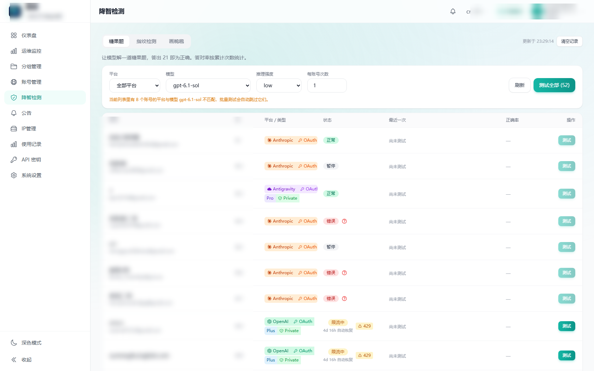

# 降智检测（Degradation Check）

> **Fork 说明：** 本仓库修复 Responses / Chat Completions 检测题目转发，保留原版菜单自动登录、加载账号及单项/批量检测。只需在检测服务设置一次 `SUB2API_BASE_URL`；所选 OpenAI API Key 账号的上游信息由服务端读取，无需重复配置每个 Key。需要时按提示完成二次验证。下文保留原项目说明，部署与兼容范围请先看 [修复版使用说明](docs/direct-upstream.md)。下文指向 `jaychou778` 的镜像和克隆命令获取的是原版，不包含本 fork 的修复。

给 AI 中转站用的**降智自检面板**：判断一个账号还是不是"原来那个模型"，有没有被偷偷降档、降级或换型号。



> 一眼看出哪些号还活着、哪些被 429 / 401、哪些画出来的鹈鹕像简笔画。

三种检测方式，覆盖三种不同的"降智"：

| 测试 | 回答什么问题 | 原理 |
|---|---|---|
| **糖果题** | 这个号还聪明吗？ | 抽屉原理应用题，正确答案是 21。看答对率、耗时、推理 token |
| **指纹检测** | 背后到底是不是我买的那个型号？ | 让模型生成 300 个随机整数，和内置参考库比对，给出最可能来自哪个模型及概率 |
| **画鹈鹕** | 画得糙不糙？想得久不久？ | 让模型用 SVG 画「骑自行车的鹈鹕」，人眼对比画面精细度和耗时 |

> 灵感与题目来自 [cpa-plugin-codex-candy-eval](https://github.com/haowang02/cpa-plugin-codex-candy-eval)（MIT）。
> 那个插件只能装在 CLIProxyAPI 上；本项目做成**独立服务**，任何中转站都能用。

---

## 为什么是独立服务，而不是插件

因为**不碰你中转站任何一行代码**：

```
你的中转站（Sub2API / 任何版本，一行不改）
   └─ 后台「自定义菜单」加一项 → iframe 嵌入本服务
        └─ 本服务（自己的前端 + 自己的 SQLite）
             └─ 用 URL 里带过来的管理员令牌调中转站的 admin API
```

好处：

- **Sub2API 随便升级**，本项目不受影响（只依赖 `/admin/accounts` 和 `/admin/accounts/:id/test` 两个稳定接口）
- 测试结果存在自己这边，不污染中转站数据库
- 不用重新编译镜像、不用停机

---

## 快速开始

### 1. 启动服务

```bash
# 方式一：直接跑镜像
docker run -d --name degradation-check \
  -p 8088:8088 \
  -v $(pwd)/data:/data \
  --restart unless-stopped \
  ghcr.io/jaychou778/degradation-check:latest

# 方式二：自己构建（推荐，能改配置）
git clone https://github.com/jaychou778/degradation-check.git
cd degradation-check
docker compose up -d --build
```

打开 `http://你的服务器IP:8088`，会看到一个连接设置页。

### 2. 接到中转站侧栏

登录你的 Sub2API 后台：

1. 进 **系统设置 → 自定义菜单**（不同版本可能叫「自定义页面」）
2. 新建一项：
   - 名称：`降智检测`
   - 图标：随便选一个（推荐盾牌 / 对勾）
   - URL：`http://你的服务器IP:8088/`
3. 保存，刷新页面

侧栏就会出现「降智检测」。点进去时，Sub2API 会自动把管理员令牌和来源地址拼到 URL 上（`?token=...&src_host=...`），**本服务直接用它们调 API，你不需要填任何东西**。

> 如果你的版本不支持 iframe 型自定义菜单，也可以直接把 `http://IP:8088/` 收藏成书签，第一次打开时手填地址和令牌。

### 3. 拿到管理员令牌（手动模式才需要）

浏览器 F12 → Application → Local Storage → 找 `auth_token`，复制那串 `eyJ...`。

---

## 怎么用它判断降智

**建议三个测试都跑一遍**，因为它们抓的是不同的东西：

| 现象 | 说明 |
|---|---|
| 糖果题 3/3 全对，耗时 40–90 秒 | 号是好的 |
| 糖果题 3/3 全对，但每次都在 5 秒内 | **推理档位被调低了**（还能答对，但没在认真想） |
| 糖果题 1/3 或 0/3 | 明显降智，或者这号本来就废了 |
| 糖果题正常，**指纹归因不是你要的型号** | **被换成了便宜的模型**（挂羊头卖狗肉） |
| 返回 `429 usage_limit_reached` | 额度用完了，不是降智，看 `resets_at` |
| 返回 `401 token_expired` | 令牌失效，要去中转站刷新 |

关于次数：工具栏的「每账号次数」默认 1，可调到 10。**看降智建议调到 3**——单次可能是运气。

---

## 指纹归因是怎么做的

内置了 [lm-detector](https://github.com/Ikaleio/lm-detector) 的参考库（4.2 MB）和归因算法（Go 移植，MIT）：

1. 让模型生成 300 个 1–355 的随机整数，重复 3 次
2. 提取数字分布的"指纹"（偏好区间、末位、相邻变化等）
3. 和参考库里各模型的指纹比对，输出概率排名

```
gpt-6-astra/6.1-sol   98.55%
gpt-6-sol              1.03%
gpt-5.6-sol            0.22%
```


**局限**（别指望它万能）：

- 只能在参考库收录的模型之间比较
- 只能说明"像谁"，不能证明"绝对是它"
- 三条回答都有效才给概率；只采到一两条只给排名
- 回答不像语言模型（被程序生成/排过序）时会标 `不像语言模型回答`，不排名

---

## 数据存在哪

`./data/degradation.db`（SQLite 单文件）。表结构很简单：

```
账号 × 测试类型 = 一行
```

**每个账号每类测试只保留最新一条**，看历史正确率靠累计计数（`total_runs` / `correct_runs`），所以表不会膨胀——永远只有「账号数 × 3」行。

备份：直接拷 `data/` 目录。迁移：把 `data/` 一起搬走。

---

## 配置

| 环境变量 | 默认 | 说明 |
|---|---|---|
| `PORT` | `8088` | 服务端口 |
| `DATA_DIR` | `./data` | SQLite 所在目录 |
| `INSTANCE_NAME` | `降智检测` | 页面左上角显示的名字 |
| `TZ` | `Asia/Shanghai` | 时区，影响记录时间显示 |

---

## 本地开发

```bash
# 后端（需要 Go 1.22+）
cd server
go mod tidy
go run .            # 监听 :8088

# 前端（另开一个终端）
cd web
pnpm install
pnpm dev            # 监听 :5173，/api 自动代理到 :8088
```

构建正式镜像：

```bash
docker build -t degradation-check .
```

---

## 常见问题

**Q：画面很小 / 不动？**
A：画面来自模型生成的 HTML，预览接口会注入一段兜底 CSS 让 SVG 填满容器。如果还是小，检查浏览器是否缓存了旧页面（Ctrl+Shift+R）。

**Q：为什么 Claude 账号跑画鹈鹕老失败？**
A：Sub2API 的测试接口默认 `max_tokens` 只有 1024，Claude 会先思考把预算烧光，返回空流。需要在 Sub2API 侧把 `createTestPayload` 的 `max_tokens` 调大（我们验证过 16384 可用）。这是 Sub2API 自身的限制，不是本项目的。

**Q：支持 NewAPI / OneAPI 吗？**
A：只要它们提供「列出账号」和「按账号测试」的 admin API，改一下 `server/upstream.go` 就能接。目前内置的是 Sub2API 的接口路径。

**Q：会不会泄露我的令牌？**
A：令牌只在浏览器 sessionStorage 和本服务的单次请求里存在，**不落库、不打日志**。服务端只把它透传给中转站。

---

## 许可

本项目以 **LGPL-3.0** 发布。

第三方：

- 题目与判定逻辑来自 [cpa-plugin-codex-candy-eval](https://github.com/haowang02/cpa-plugin-codex-candy-eval)（MIT）
- 指纹参考库与归因算法来自 [lm-detector](https://github.com/Ikaleio/lm-detector)（MIT），见 `server/lmdetector/data/lm-detector/LICENSE`
- 接口约定参考 [Sub2API](https://github.com/Wei-Shaw/sub2api)（LGPL-3.0）
